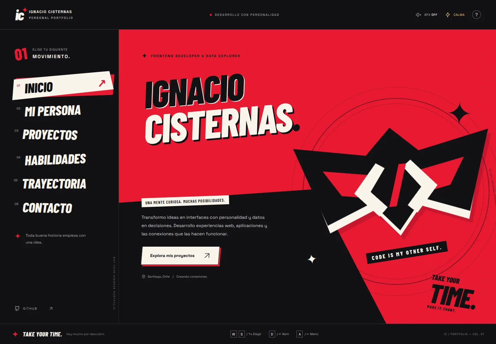
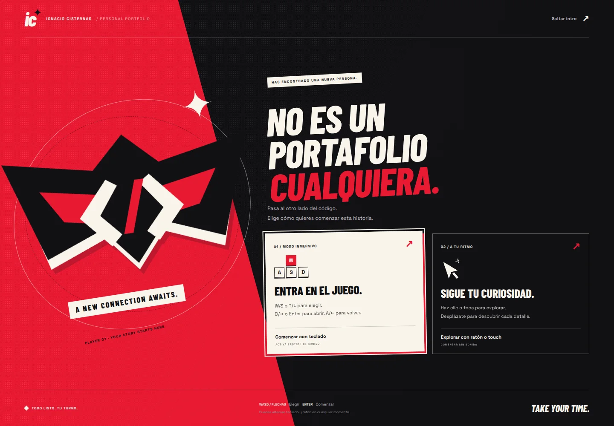
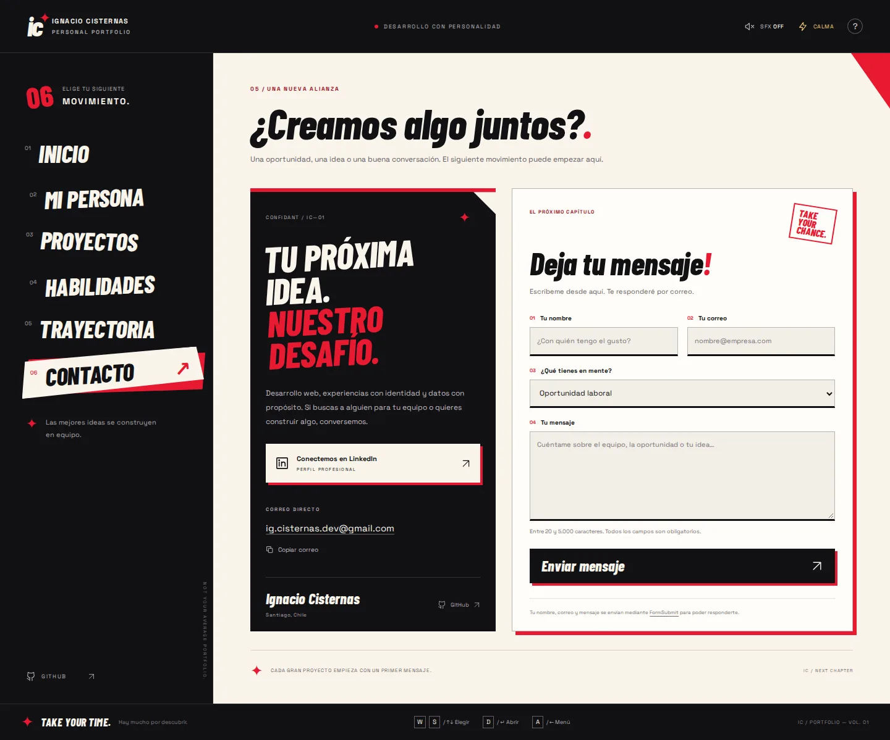

# Ignacio Cisternas · Personal Portfolio

**Take your time. Make it count.**

Portafolio interactivo en español, inspirado en el lenguaje visual de los menús de **Persona 5 Royal**: recortes diagonales, tipografía expresiva, rojo/negro/blanco y navegación por teclado. Construido con React, TypeScript y Vite.



[Ver la versión móvil](docs/preview-mobile.webp)



[Ver la bienvenida en móvil](docs/preview-welcome-mobile.webp)



[Ver Contacto en móvil](docs/preview-contact-mobile.webp)

## Qué incluye

- **Inicio:** identidad visual propia y una máscara original que combina símbolos de código.
- **Mi persona:** perfil, formación e intereses profesionales.
- **Proyectos:** Gimae! en desarrollo avanzado y tres casos del ecosistema Albion, filtros por área, expedientes y enlaces a código, producto y documentación.
- **Habilidades:** frontend, mobile, backend y datos/BI.
- **Trayectoria:** formación, práctica profesional y proyectos.
- **Contacto:** LinkedIn como canal profesional principal, correo visible y copiable, formulario integrado y GitHub como enlace secundario.
- **Bienvenida:** pantalla de entrada animada con dos formas de explorar, instrucciones WASD/flechas y carga real de fuentes. Se muestra una vez por pestaña y puede repetirse desde la ayuda.
- Diseño adaptable a escritorio y móvil, navegación por hash, historial del navegador, foco visible, enlace para saltar al contenido y diálogos accesibles.
- Efectos originales de sonido con Web Audio: solo se activan al elegir explícitamente el modo inmersivo o SFX. La entrada con ratón/touch comienza sin sonido. Preferencias locales de sonido y movimiento, con respeto a `prefers-reduced-motion`.
- Fuentes autoalojadas; sin servicios de seguimiento, vídeos, música o imágenes remotas necesarias para renderizar la interfaz.

## Desarrollo local

Requiere **Node.js 22.12 o superior**.

```bash
npm ci
npm run dev
```

Vite muestra la dirección local en la terminal. Para compilar y revisar la versión de producción:

```bash
npm run build
npm run preview
```

## Personalización

| Archivo | Contenido |
| --- | --- |
| `src/data.ts` | Nombre, contacto, enlaces, proyectos y grupos de habilidades |
| `src/App.tsx` | Secciones, biografía, trayectoria, interacciones y gráficos SVG |
| `src/Contact.tsx` y `src/contact.css` | Contacto, formulario, estados de envío y diseño de la tarjeta |
| `src/Welcome.tsx` y `src/welcome.css` | Pantalla de bienvenida, instrucciones y transición de entrada |
| `src/navigation.ts` | Mapeo WASD/flechas, selección de controles y protección de campos editables |
| `src/styles.css` | Colores, tipografías, composiciones, animaciones y breakpoints |
| `public/favicon.svg` | Icono propio del portafolio |
| `index.html` | Idioma, descripción y metadatos iniciales |

`profile.email` y `profile.linkedin` contienen los contactos públicos del autor. El correo es visible, tiene un enlace `mailto:` y se puede copiar. El formulario permite escribir sin salir del portafolio. El teléfono se omite del sitio público para priorizar LinkedIn y correo.

### Activar el formulario de contacto

GitHub Pages sirve archivos estáticos; el envío se realiza a través de [FormSubmit AJAX](https://formsubmit.co/ajax-documentation), sin contraseñas de Gmail ni claves privadas en el frontend.

1. Publica estos cambios en Pages (workflow manual, instrucciones más abajo).
2. Abre la sección **Contacto** de la URL publicada y envía una prueba con tu propio correo. La primera petición dispara la activación del destinatario.
3. Revisa `ig.cisternas.dev@gmail.com`, incluida la carpeta de spam, y pulsa **Activate Form** en el correo de FormSubmit. Esta verificación del buzón solo la puede completar su propietario.
4. Vuelve a enviar una prueba desde la URL publicada y comprueba su recepción. No uses una prueba local como evidencia de recepción en producción.

El formulario incluye nombre, correo de respuesta, motivo y mensaje. Valida campos obligatorios, evita dobles clics durante una petición, usa un campo trampa para bots y limita la espera a 20 segundos. Una respuesta de activación, rechazo o error conserva el borrador. Solo una respuesta afirmativa del proveedor muestra la aceptación y limpia los campos; esa respuesta **no prueba que el mensaje haya llegado a la bandeja de entrada**. No hay reintentos automáticos si la conexión se interrumpe.

El aviso de privacidad enlaza las condiciones del servicio. El modo AJAX se configura sin reCAPTCHA externo para mantener el envío dentro de la página; depende de los filtros y límites de FormSubmit. Si se cambia el correo en `src/data.ts`, será necesario activar el nuevo destinatario. Las pruebas automatizadas interceptan el servicio: no envían correos reales ni activan buzones.

Los casos de Albion se prepararon con sus README en septiembre de 2026. Gimae se añadió tras revisar su README de `main` en octubre de 2026: se presenta como desarrollo avanzado y sus pagos como integraciones de prueba, sin afirmar que haya cobros Live activos. Biografía, trayectoria y habilidades son editables; revisa el texto antes de usarlo en postulaciones. No se muestran niveles porcentuales inventados ni se afirma una titulación oficial.

## Navegación

| Control | Acción |
| --- | --- |
| Click / toque | Abrir sección o proyecto |
| W / S o ↑ / ↓ | Elegir una sección; dentro del contenido, recorrer sus botones y enlaces |
| D / → / Enter | Abrir la opción enfocada o entrar en el contenido de la sección |
| A / ← | Volver al menú; dentro de un diálogo, cerrarlo |
| Tab / Shift + Tab | Recorrer controles |
| Escape | Cerrar un diálogo; fuera de él, volver al inicio |
| ? | Mostrar la ayuda |
| Rueda / Page Up / Page Down | Desplazarse para leer el contenido |

En la bienvenida, WASD o las flechas cambian la opción inicial y Enter confirma. **Modo inmersivo** activa los efectos de sonido y deja el foco en el menú; **A tu ritmo** entra sin sonido. Puedes alternar teclado, ratón y touch sin cambiar de modo. Saltar la intro o pulsar Escape permite entrar de inmediato, incluso mientras se preparan las fuentes. La carga tiene un límite de espera de 1,5 segundos y nunca deshabilita los botones.

Las flechas funcionan también después de abrir una sección con el ratón o de enfocar un encabezado. Los atajos respetan campos de texto, controles nativos, combinaciones con Ctrl/Alt/Meta y composición de texto. En los diálogos permanecen dentro de la ventana activa. La ayuda permite **volver a ver la bienvenida** sin borrar preferencias.

Las rutas `#inicio`, `#perfil`, `#proyectos`, `#habilidades`, `#trayectoria` y `#contacto` pueden compartirse. El menú móvil se desplaza horizontalmente para conservar controles cómodos sin ocultar secciones.

## Verificación

```bash
npm run build
npx playwright install chromium
npm run test:e2e
```

Las pruebas ejecutan el build real en escritorio y móvil. Cubren rutas, filtros, detalles, foco y teclado, historial, preferencias, movimiento reducido, errores de portapapeles, filtros y expediente de Gimae, validación y estados de envío del formulario (con el proveedor interceptado), y archivos estáticos bajo `/portfolio/`. También reproducen la navegación desde el contenido, un recorrido completo de proyectos solo con WASD, primera visita, entrada por ambos modos, repetición y omisión de la bienvenida, enlaces directos y almacenamiento no disponible.

## Publicar con GitHub Pages

El código está preparado para servir `dist/` en una raíz o subcarpeta gracias a `base: './'` y las rutas hash. La creación de este repositorio **no activa por sí sola un sitio publicado**.

1. Abre **Settings → Pages** y elige **GitHub Actions** como fuente.
2. En **Actions → Deploy to GitHub Pages**, selecciona **Run workflow** sobre `main`.
3. El job de despliegue mostrará la URL publicada. Para aplicar cambios posteriores, ejecuta nuevamente el workflow.

La publicación es manual. El workflow **Quality** verifica instalación, TypeScript, build e interacciones en cada push a `main` y en los pull requests.

## Referencias y créditos

- Referencia visual solicitada: [ffaneto/persona5-website-theme](https://github.com/ffaneto/persona5-website-theme). Se revisaron su menú, navegación por teclado y enfoque de transiciones.
- Esta implementación es independiente: no copia el código, fuentes, vídeos, música ni personajes de ese repositorio. No se encontró un archivo de licencia en su árbol al revisarlo.
- Persona 5 Royal pertenece a sus respectivos titulares, ATLUS y SEGA. Este portafolio no está afiliado a ellos.
- Barlow Condensed y Space Grotesk se distribuyen mediante Fontsource bajo SIL Open Font License. Las licencias están incluidas en sus paquetes de dependencias.
- No se ha elegido una licencia de distribución para el código original de este portafolio; su autor puede añadirla.
